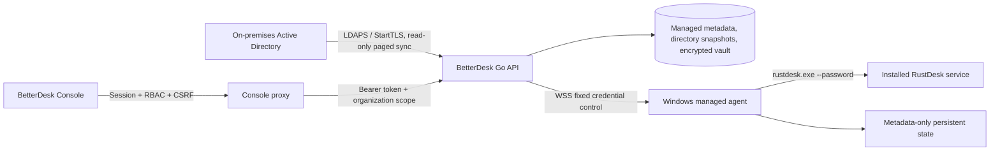

# ADR-0001: Managed AD Devices and Temporary RustDesk Credentials

## Status

Accepted

## Context

The first release must manage on-premises Active Directory computers and OUs, map devices to existing BetterDesk organizations, enforce independently assignable permissions, and allow authorized administrators to view a temporary RustDesk connection password. The system must not collect users' existing permanent passwords and must not provide a general-purpose remote shell.

BetterDesk already provides LDAP/AD sign-in, organization and device RBAC, an AES-256-GCM peer credential vault, and the CDAP device command channel.

## Decision

- Extend BetterDesk instead of creating a separate management control plane.
- Synchronize AD users, groups, computers and OUs read-only. Match computers to RustDesk peers by normalized unique hostname and map their OU to an explicitly configured organization.
- Generate a 24-character temporary password on the server. Send it only inside an authenticated CDAP TLS command to the fixed `betterdesk.managed_credential` control.
- Persist a plaintext password in the existing encrypted peer vault only after the Windows managed agent confirms the RustDesk command succeeded.
- Require `credential.view` to decrypt and view a valid password and `credential.rotate` to rotate or revoke it. Directory operations require `directory.view` or `directory.sync`.
- Keep password material out of command responses, events and application logs. The agent stores only request metadata and expiry state, never the plaintext password.
- Restore password rotation on the agent when a credential expires, including after agent restart or network loss. Server cleanup marks the credential expired and removes it from the vault.
- Use mutually exclusive server-side rotate/revoke operations to avoid mismatches between the endpoint and vault.
- Keep optional managed-AD storage, CDAP waiting, API runtime state and Console routes in separate modules. Register API routes through the existing authenticated secure-HTTP boundary and stop background workers through `http.Server.RegisterOnShutdown`; avoid modifying BetterDesk's largest core server, database and device-page files.

## Architecture

## Consequences

### Positive

- Existing authentication, organization RBAC, vault encryption and CDAP transport are reused.
- A connection permission does not implicitly grant password disclosure.
- Temporary credentials expire both centrally and locally; agents can recover pending expiry work after restart.
- AD synchronization is read-only and does not start periodically until an administrator configures an interval.

### Negative

- Windows devices must run the additional managed agent and have a supported, installed RustDesk service.
- Rotation requires an online CDAP connection, valid device credentials and a configured vault key.
- Hostname collisions are intentionally marked ambiguous and require manual correction.

### Neutral

- Directory snapshots and managed credential metadata are stored in SQLite or PostgreSQL through new automatic migrations.
- The fixed CDAP widget may appear in device manifests even though credential management has its own server-side permissions.

## Alternatives Considered

- **Collect existing permanent passwords:** rejected because it expands credential exposure and was explicitly excluded from scope.
- **General shell/PowerShell agent:** rejected because a fixed two-action control has a much smaller attack surface.
- **Client-generated password returned to the server:** rejected because passwords would need to traverse responses and could leak through generic event/log paths.
- **Separate RustDesk API product:** rejected to avoid duplicating BetterDesk LDAP, RBAC, vault and CDAP infrastructure.

## Failure Modes

| Failure | Behavior |
| --- | --- |
| Agent offline or command timeout | Rotation fails closed; no new plaintext is returned or vaulted |
| RustDesk rejects password change | Agent reports failure without echoing command output or password |
| Vault encryption/write fails after endpoint change | Credential remains non-active and cannot be viewed; administrator must rotate again |
| Agent restarts before expiry | Persisted metadata schedules local expiry recovery without needing the plaintext |
| Credential expires | Server removes the vault item; normal vault APIs cannot disclose it |
| Concurrent rotate/revoke requests | Server serializes operations |

## References

- `docs/MANAGED_AD_CREDENTIALS.md`
- `managed-agent/README.md`
- BetterDesk LDAP/AD, Organizations/RBAC, Fleet/Policies and CDAP documentation
